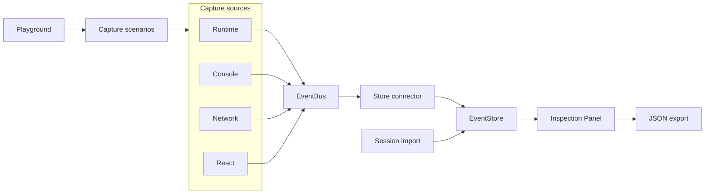
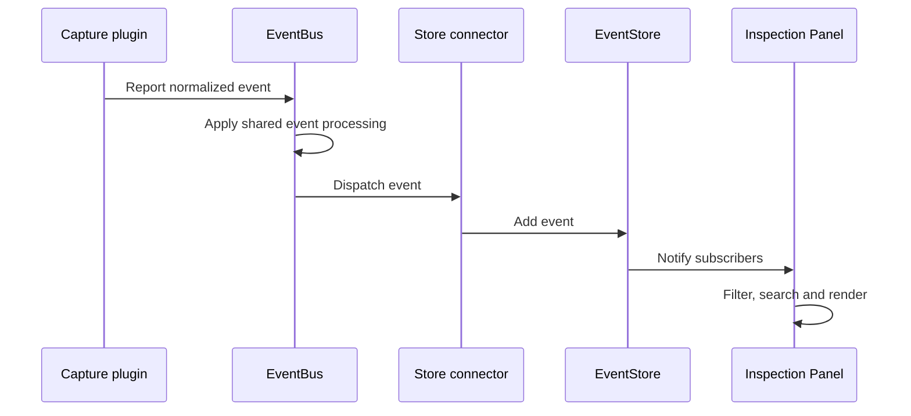
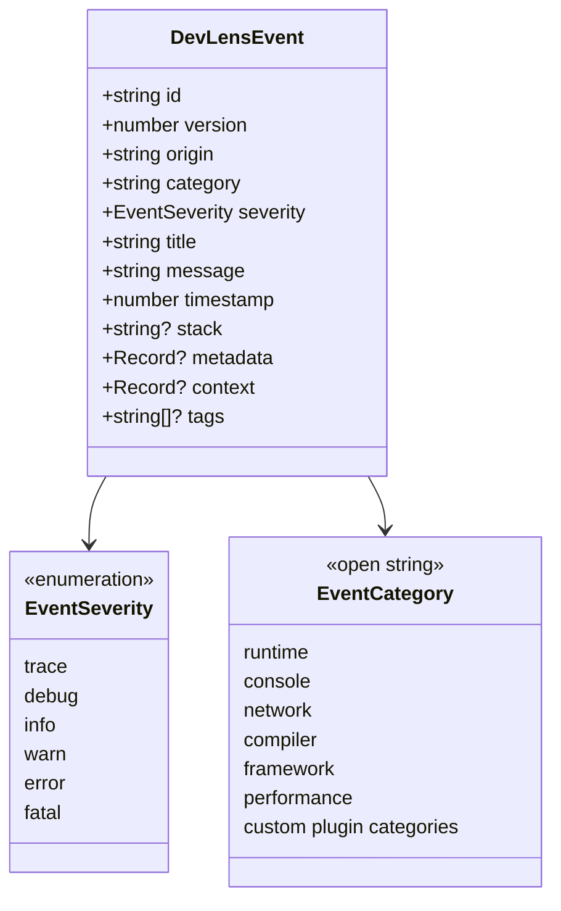
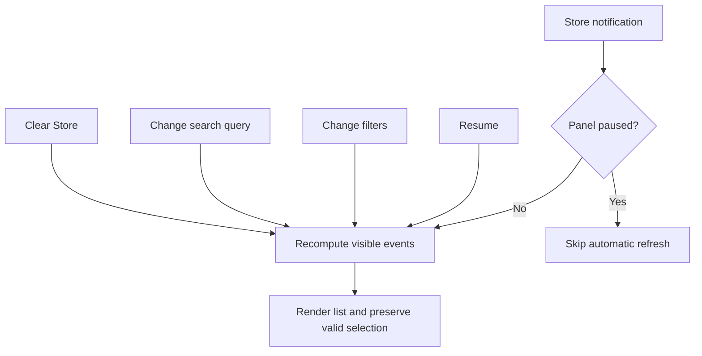

# DevLens

**An embeddable browser diagnostics engine.** DevLens captures runtime errors, console calls, Fetch/XHR outcomes, and React component errors, converts them into one common event format, stores them, and displays them in an in-page inspection overlay.

DevLens separates **capture, distribution, storage, and presentation**. Capture sources are plugins, the Store is independent of them, and the Panel is a consumer of the Store, never a capture mechanism.

---

## Key capabilities

- **Runtime error capture:** browser errors and unhandled promise rejections.
- **Console interception:** wraps console methods while preserving native console output.
- **Network capture:** Fetch and asynchronous XHR, with outcome classification, query-value redaction, and response metadata.
- **React error reporting:** an error boundary that reports caught component errors with component-stack information.
- **Unified event model:** every source emits the same versioned event shape.
- **Extensible by design:** event `category` is an open string, so custom plugins can define their own categories.
- **Inspection Panel:** filter by category and severity, case-insensitive search, keyboard navigation, pause/resume, clear, and an event inspector.
- **Session export and import:** serialize the full Store as JSON and restore it later with whole-session validation.
- **Playground app:** a verification app that exercises each capture path so you can watch events appear in the overlay.

---

## Architecture

Multiple capture sources feed one event pipeline. The connector between the EventBus and the EventStore is what keeps the Store independent of the capture plugins. Imported sessions can populate the Store separately. The Panel displays stored events and exports sessions, but is never responsible for capture.



### Event lifecycle

Capture plugins normalize raw browser or framework events before reporting them. Network outcome classification and URL redaction happen in the plugin, upstream of the Bus. The Bus applies shared event processing and dispatches; the connector adds events to the Store.



> The exact order of ID/version/timestamp assignment, middleware, freezing, and replay retention inside the Bus is documented in [`docs/ARCHITECTURE.md`](docs/ARCHITECTURE.md).

### Event schema

This is a data contract, not a database schema. All capture sources emit this shape. `severity` is a closed set. `category` is an open string, so plugins may define their own values; the ones listed are examples. `metadata` and `context` are structured key-value objects.



The versioned event type is defined in [`packages/core/src/types.ts`](packages/core/src/types.ts).

### Panel refresh behavior

Pause blocks only the automatic refresh triggered by Store notifications. Capture and Store updates continue while paused, and explicit actions (changing filters, changing the search query, clearing, resuming) still update the Panel.



---

## Getting started

### Prerequisites

- Node.js and [pnpm](https://pnpm.io/). This is a pnpm workspace monorepo; use the versions pinned in the repository's configuration.

### Install, build, and run the playground

```bash
git clone https://github.com/Mystify7777/devlens.git
cd devlens

pnpm install
pnpm build
pnpm --filter @devlens/playground dev
```

The playground triggers each capture path (runtime errors, console calls, Fetch/XHR, React errors) so you can observe the resulting events in the overlay.

### Repository checks

```bash
pnpm test
pnpm typecheck
pnpm format:check
```

Other root scripts: `build`, `clean`, `format`.

---

## Public API

Each package exposes a public entry point. Instances and plugins returned by those entry points carry their own methods. Internal helpers (for example, the normalization functions) are not part of the supported API and are listed, marked internal, in [`docs/API.md`](docs/API.md).

| Package | Public entry point | Returned methods | Responsibility |
| --- | --- | --- | --- |
| Core | `createEventBus`, `createEventStore` | Instance-specific methods | Event distribution and storage |
| Runtime | `createRuntimePlugin` | Plugin lifecycle methods | Browser runtime error capture |
| Console | `createConsolePlugin` | Plugin lifecycle methods | Console interception |
| Network | `createNetworkPlugin` | Plugin lifecycle methods | Fetch/XHR capture |
| React | `createDevLensErrorBoundary` | React component API | Component error reporting |
| Panel | `createPanel` | `install`, `uninstall`, filtering, search, session controls, visibility and theme methods | Inspection UI |

---

## Documentation

- [`docs/README.md`](docs/README.md): documentation index
- [`docs/ARCHITECTURE.md`](docs/ARCHITECTURE.md): system and event-flow diagrams
- [`docs/EVENT_SCHEMA.md`](docs/EVENT_SCHEMA.md): event contract
- [`docs/API.md`](docs/API.md): public APIs and internal responsibilities
- [`docs/DEVELOPMENT.md`](docs/DEVELOPMENT.md): setup, scripts, tests, troubleshooting
- [`docs/specs/`](docs/specs/): specifications, including `inspection.md` and `session-import.md`
- [`docs/adr/`](docs/adr/): architecture decision records
- [`docs/research/`](docs/research/): research notes

---

## Design notes

- **Capture is decoupled from display.** The Panel reads from the Store and never captures events itself.
- **The connector keeps the Store independent.** The Store has no knowledge of capture plugins.
- **Normalization happens upstream of the Bus.** Network classification and URL redaction are done by the plugins, keeping the Bus generic.
- **No application database.** The EventStore is in-memory; the data model is the event contract above, not a persistent database schema.
- **Pause affects automatic refresh only.** Capture and Store updates continue while the Panel is paused.

---

## License

See the repository's `LICENSE` file.
